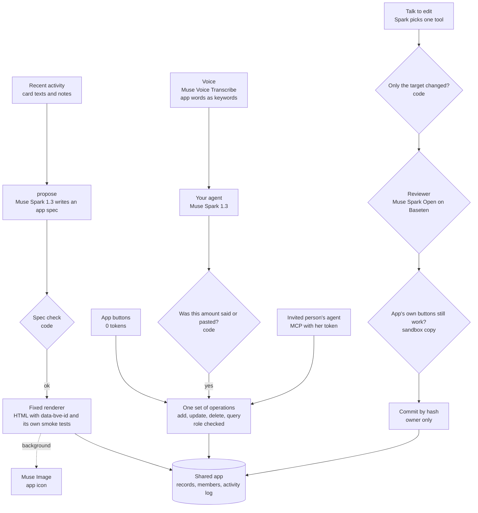

# Repeat less, together

An agent that notices a chore you keep repeating, builds a small app for it, and then does the repeats inside that app with you and the people you invite.

It is built around two things: the person should do less, and Muse should spend far fewer tokens. The model works once, to design the app. After that a repeat is a tap in the app (0 tokens) or one short question to the app (about 3,000 tokens, the same with 3 months or 12 months of history).

Built during the Meta Global AI Developer Hackathon (Oct 26 to Nov 4, 2026), Indie track, "Build for Your World". Everything in this repository was written during the event.

## What it does

1. **Notice.** The agent reads two weeks of card payment texts and notes, finds the chore that repeats most (here, 34 card texts copied into a household ledger by hand) and writes a spec for an app that handles it. It writes a spec, not code. The spec is checked by code before anything is built.
2. **Build.** A fixed renderer turns the spec into a phone app. Muse Image draws its icon in the background. Three months of past payments are imported.
3. **Use.** Paste a card text, or say it. Muse Voice Transcribe hears it, using the words this app already knows as keywords, and Muse Spark 1.3 turns it into one `add_record` call. A question such as "지난달 외식비 얼마야?" becomes one `query_records` call, so the total comes from code instead of the model adding up hundreds of records.
4. **Together.** The owner invites a family member as a member. Her own agent can connect to the same app over MCP with her token. Everyone, person or agent, goes through the same operations with the same role checks: a member can add records and ask questions, but cannot change amounts, delete history or change how the app looks.
5. **Change the look by talking.** The owner says "추가 버튼 색을 초록색으로 바꿔줘". The editor picks one tool, code checks that only the target changed, a second model reviews it, and the app's own buttons are clicked in a sandbox copy. Only then does the change go live for everyone. A change that would break the add button is kept back.

## Measured results

All runs use the same model (Muse Spark 1.3 on the Meta Model API) and the same requests. Raw results are in `results/`.

**Asking the app instead of reading the history** (`scripts/bench_read.mjs`, 10 questions × 2 runs, answers checked against totals computed by code)

| History | Reading the raw card texts | Asking the generated app |
|---|---|---|
| 3 months, 336 payments | 17/20 correct, 9,699 tokens per question | **20/20 correct, 3,141 tokens** |
| 12 months, 1,318 payments | 18/20 correct, 33,114 tokens per question | **20/20 correct, 3,067 tokens** (91% fewer) |

Reading the raw texts costs more as the history grows. Asking the app stays flat, because the model sees the app's fields and gets back one exact number.

**Changing and building an app** (`scripts/bench_tokens.mjs`)

| | The usual way: write and rewrite the whole file | This project |
|---|---|---|
| One change, average of 7 | 5,913 tokens, 3,018 of them output | **3,979 tokens, 299 output**, 64% lower cost |
| One change to the 14 KB ledger app | about 9,200 tokens | **about 3,500 tokens** |
| One change to the 5 KB café app | about 3,450 tokens | about 4,300 tokens (more tokens, still lower cost) |
| Building the app, once | 6,521 tokens, 42.9 s | 7,967 tokens, 35.9 s, 22% lower cost |

Rewriting the file costs more as the app grows, and output tokens cost 3.4 times as much as input tokens. One tool call per change stays about the same size. On a very small app the rewrite uses fewer tokens. Building the app is a one-time cost and is not where the savings are. Every change here is also reviewed by Muse Spark Open on Baseten, which adds about 620 tokens per change. That reviewer is not counted in the Muse token figures above. The checks make a change about 2.5 seconds slower (median 13.2 s against 10.7 s).

**Editor reliability gate** (`scripts/gate.mjs`, 10 requests × 4 runs on the café app): 40/40 correct, 0 silent wrong edits, median 9.4 s, $0.22 for all 40. An earlier run found 2 wrong in 20: when the reviewer rejected a change, that change was left in place and the retry stacked on top of it. Rejected changes are now rolled back before the retry.

## How it works



The rules that keep it safe and cheap:

- **The model never writes code.** An app is a spec that code validates and a fixed renderer builds. A change is one call from a fixed tool set on an element with a known `data-bve-id`.
- **One set of operations for everyone.** The app's buttons, your agent, and an invited person's agent over MCP all call the same functions in `src/app/ops.js`, with the same role checks and the same activity log. Refused attempts are logged too.
- **Numbers come from code.** Totals and counts come from `query_records`. The agent may only write an amount that appears in what the person said or pasted (`src/app/numbers.js` reads "22,500원", "2만 2500원" and "이만 이천오백 원" alike). If the two hearings of a voice request disagree on the amount, the record is held and the person saves it with one tap.
- **Voice is heard twice.** One pass uses the app's own words as keywords and one does not, in parallel. With the app's words, "고기찍 하루에서 … 의식" became "고깃집 화로에서 … 외식". Without them, a spoken 12,300원 was once heard as 2,300원, which is why amounts are compared by code.
- **A look change goes live only after the app still works.** Deterministic checks first (only the target changed, and a colour change must keep its text readable at a 3:1 contrast or better), then the reviewer, then the app's own buttons in a sandbox, then a commit that only accepts a layout the server produced (by hash). The contrast check was added after a run where "make the add button green" turned the button's text green on a green button and every other check passed.

## Meta models used

- **Muse Spark 1.3** over the Responses API, with reasoning carried across turns by `previous_response_id`: spotting the chore and writing the spec, working inside the app, planning look changes, and the demo's outside MCP agent.
- **Muse Spark Open** (open weights) on Baseten: the independent reviewer for every look change.
- **Muse Voice Transcribe**: spoken requests, with keyword biasing from each app's own vocabulary.
- **Muse Image**: one icon per generated app, flat and in the app's colour.

Not used yet: SAM 3.1. The natural place for it is a shop's menu app, cutting each item out of a photo by name.

## Run it

```bash
cp .env.example .env        # add META_API_KEY, and REVIEW_API_KEY for the reviewer
scripts/fetch_muse_assets.sh # Muse avatar clips and icons for the demo, fetched from muse.ai
node src/server.js          # http://localhost:8787/muse
```

No dependencies. Node 18 or newer. `/muse` is the demo shown in the video: two Muse phones with the app as an artifact, and a ledger of what ran and which model or code check handled it. The Muse screens are a mock-up, since Muse is not available in Korea; the app, its tools and every number are live. Meta's avatar clips and icons are not in this repository; `scripts/fetch_muse_assets.sh` downloads them into `public/muse-assets/`. `/studio` is the earlier version of the demo, and `/` is the original single-app editor demo. Voice sample clips are made with `scripts/make_voice_samples.sh` (macOS `say` and ffmpeg); the hold-to-talk button uses the microphone.

Reproduce the numbers:

```bash
node --test                                   # unit tests
node scripts/gate.mjs 4 6                     # editor reliability gate
node scripts/bench_read.mjs 2 4               # asking the app vs reading 3 months
BENCH_FROM=2025-11-04 node scripts/bench_read.mjs 2 4   # 12 months
node scripts/bench_tokens.mjs 4               # change and build, both ways
node scripts/mcp_agent.mjs http://127.0.0.1:8787/mcp/<appId> <token> "지난달 외식비 얼마야?"
```

## Layout

- `src/app/agentops.js` - spot the chore and write the spec; work inside an app with its own tools
- `src/app/spec.js` - the spec schema and its validator
- `src/app/render.js` - the fixed renderer and the shared app runtime with its smoke tests
- `src/app/ops.js` - add, update, delete, query, summaries, roles
- `src/app/numbers.js` - every amount in a text, in digits or Korean words
- `src/app/media.js` - Muse Voice Transcribe and Muse Image
- `src/app/mcp.js` - the per-app MCP server
- `src/app/routes.js` - HTTP routes for apps, members, voice, icons and look changes
- `src/tools.js`, `src/verify.js`, `src/review.js`, `src/agent.js` - the verified talk-to-edit editor
- `src/demo/` - synthetic household data and the outside MCP agent
- `public/muse.html` - the demo inside a Muse mock-up
- `public/studio.html` - the earlier demo
- `scripts/` - benchmarks and the reliability gate

## Limits

- This is a local demo. Data is kept in a JSON file, and the demo phones carry their member token in the URL.
- All data is synthetic. No real person's payments are used.
- The MCP endpoint follows the JSON response form of the MCP HTTP transport and is tested with the client in `src/demo/mcpclient.js`. It has not been tried inside Muse, which is not available in Korea.
- Voice was tested with short Korean clips from macOS voices, up to 15 seconds each.
